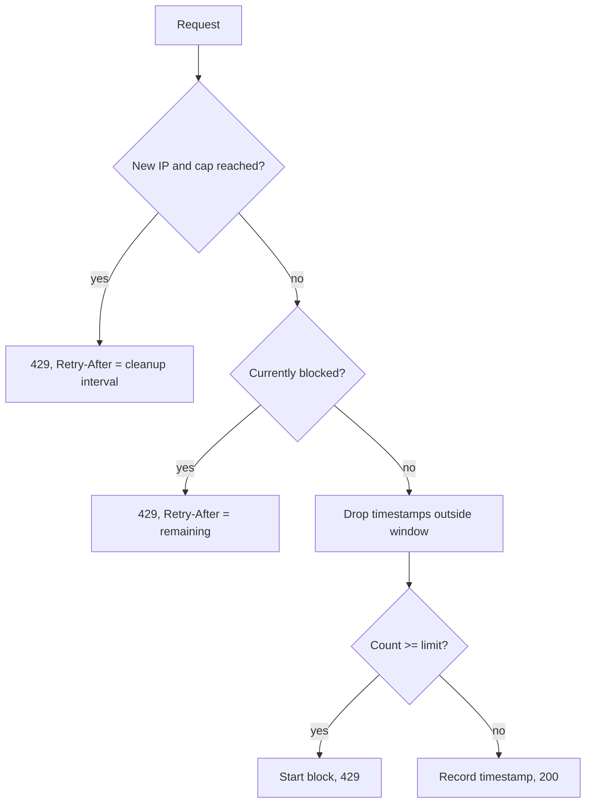

# Architecture

## Modules

| Path | Responsibility |
|---|---|
| `src/bin/main.rs` | Entry point: loads and validates config, calls `http_limiter::run` |
| `src/lib.rs` | Public API re-exports |
| `src/config.rs` | `Config`, environment parsing, validation |
| `src/state.rs` | `AppState` shared between handlers and the cleanup task |
| `src/router.rs` | `build_router`: route table |
| `src/handlers.rs` | `/check`, `/metrics` and health handlers |
| `src/cleanup.rs` | Background idle-IP eviction |
| `src/server.rs` | Binds the listener, starts cleanup, serves |
| `src/error.rs` | `Error` type and HTTP mapping |
| `tests/api.rs` | Integration tests using `build_router` and `tower::ServiceExt::oneshot` |

## State

`AppState` holds:

- `config`: immutable `Config`
- `ip_records`: `RwLock<BTreeMap<IpAddr, IpRecord>>`, where `IpRecord` has a `VecDeque<Instant>` of timestamps and an optional `blocked_until`
- atomic counters backing [metrics](features/metrics.md)

## Request flow (`POST /check`)

## Concurrency

- One `RwLock` guards all IP records. `/check` takes the write lock; `/metrics` and liveness take read access.
- The lock is held briefly and never across an `.await`.
- A poisoned lock yields `503` from handlers; cleanup skips its pass.
- Counters are lock-free atomics.

## Known improvement ideas

- Sharded map (e.g. `dashmap`) to reduce write-lock contention
- Graceful shutdown on SIGTERM / Ctrl-C
- `tracing` instead of `println!`
- A metrics crate instead of hand-formatted text
